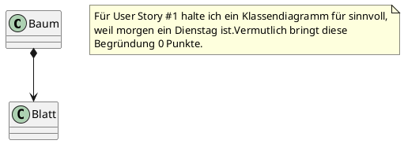
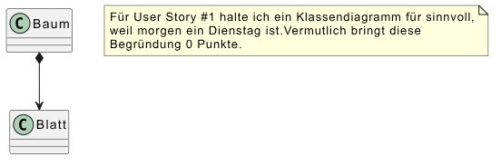

# Modularbeit 2 - Allgemeine Anforderungen

> **Hinweis:** Dieses Dokument beschreibt die allgemeinen Anforderungen an die Modularbeit.
> Projektdetails und die Spezifikation der REST API werden in separaten Abschnitten ergänzt.

**WICHTIG** Lesen Sie dieses Dokument sorgfältig und vollständig, bevor Sie die Projektbeschreibung lesen und mit Ihrer Umsetzung beginnen!

## Inhaltsverzeichnis

[[_TOC_]]

## Überblick

Wesentliche Bestandteile dieser Modularbeit sind:

* Software Entwicklung im Team
* Modellierung mit Hilfe von UML
* Anwendung von Entwurfsmustern

Sie entwickeln innerhalb dieses GitLab-Projekts die vorgegebene REST API weiter.

> **WICHTIG:** Ihr Projekt wird an vielen Stellen automatisiert auf Korrektheit geprüft werden.
> Achten Sie daher unbedingt darauf, dass Sie **exakt die geforderten Namen** verwenden.
> Ein falscher Name führt zu fehlschlagenden Tests - und damit zu null Punkten für die betroffene Aufgabe.


## Hinweise zur Nutzung von KI

**KI Nutzung im Rahmen dieser Modularbeit:**

Im Rahmen dieser Modularbeit dürfen Sie KI-Tools (z.B. ChatGPT, Copilot, etc.) nutzen.
Sie müssen die Nutzung von KI-Tools allerdings in Form von Gitlab Issues protokollieren und reflektieren.
Erstellen Sie für jede KI-Nutzung ein Issue mit Hilfe des unter `.gitlab/issue_templates/KI Nutzung.md` vorgegebenen Templates.

**Pflichtbedingung:** Wie im ersten Teil gilt auch in dieser Modularbeit, dass nicht dokumentierte KI-Nutzung als Täuschungsversuch zählt und somit zur Bewertung der gesamten Arbeit mit 0 Punkten führt.

## 1. Teamarbeit

Im Rahmen dieses zweiten Teils werden Sie im Team an der Weiterentwicklung des vorgegebenen Projekts arbeiten.
Sie haben eine weitere E-Mail von mir erhalten, die an beide Team-Mitglieder ging.
Der E-Mail entnehmen Sie die E-Mail Ihres Projektpartners / Ihrer Projektpartnerin.
Kontaktieren Sie Ihre(n) Projektpartner:in möglichst zeitnah nach Zuweisung der Modularbeit. Sie finden die Kontaktdaten in der von mir versendeten E-Mail. 
Stimmen Sie sich im ersten Termin ab, wer an welcher User Story arbeiten wird.

**Wichtig:** 

* Stimmen Sie sich unbedingt bis spätestens Montag, den 15.6. im Team ab! Sollte Ihr Projektpartner / Ihre Projektpartnerin  bis zum 15.6. nicht auf Ihre Kontaktaufnahme reagieren, sagen Sie mir bitte unbedingt bis Montag, 15.6. 23:59 Uhr Bescheid! Ich werde dann versuchen Sie mit einem neuen Partner / einer neuen Partnerin zusammenzubringen, oder selbst Ihr Entwicklungspartner werden. 
* Die Arbeit ist nach Weights gerecht aufzuteilen (siehe auch "2. Zuteilung der User Stories").
* Eine Entwicklung vorwiegend im Alleingang wird mit 0 Punkten gewertet!

**Empfehlungen für die Teamarbeit:** 

* Vereinbaren Sie bei Ihrem ersten gemeinsamen Termin einen einfachen Kommunikationsweg.
* Eine kurze Abstimmung von 5 Minuten täglich bringt häufig mehr als 100 E-Mails.
  Vereinbaren Sie daher für die Bearbeitungszeit möglichst tägliche Termine für kurze (!) Online- oder Präsenztreffen.
  Diese erlauben eine möglichst reibungslose Kommunikation und vermeiden viele E-Mails. 
* Planen Sie für den Ende des Sprints mindestens 2-3 etwas längere Termine für die Integrationsarbeit. 
* Je nachdem wie eng Sie während des Sprints zusammenarbeiten, werden die Termine zur Integrationsarbeit kurz und zufriedenstellend, oder lang und anstrengend ausfallen. 


## 2. Zuteilung der User Stories

Die zu entwickelnden User Stories sind im Gitlab-Projekt bereits vorgegeben.
Kontaktieren Sie Ihre(n) Projektpartner:in möglichst zeitnah nach Zuweisung der Modularbeit und stimmen Sie sich ab, wer an welcher User Story arbeiten wird.
Weisen Sie sich im Rahmen der Abstimmung jeweils Ihre User Stories in Gitlab unter "Assignee" zu, um so Ihre Entscheidung zu dokumentieren.

## 3. Gitlab Workflow

Sie planen, dokumentieren und setzen die User Stories nach dem gewohnten Gitlab Workflow um. 
Sie sind verpflichtet, für jede User Story einen eigenen Merge Request inklusive zugehörigem Branch zu erstellen, welcher alle Änderungen, Diagramme, usw., die die User Story betreffen, enthält.

Änderungen im Vergleich zum ersten Teil der Modularbeit:

* Konfigurieren Sie das Gitlab-Projekt unter "Project -> Settings -> Merge requests" so, dass der Merge Request nur gemergt werden kann:
  - wenn alle Reviews (threads) erfolgreich aufgelöst wurden und
  - die Pipeline erfolgreich durchgelaufen ist, d.h. der Status "grün" ist.

Alle Änderungen eines Merge Requests müssen von dem Projektpartner / der Projektpartnerin gereviewt werden. 
Konfigurieren Sie also unter Project -> Settings -> Merge requests, dass 

* für die Durchführung eines Merges mit Hilfe eines Merge Requests mind. 1 Approval notwendig ist. 
* Ein Approval durch den Erzeuger des MRs darf nicht möglich sein.
* Mit einem neuen Commit müssen alle Approvals wieder zurückgesetzt werden.


**Wichtig:** 
* Die Merge Methode für Merge Requests muss "Merge Commit" bleiben. 
* Squash commits sind nicht erlaubt.

Weisen Sie alle Ihre Merge Requests Ihrem Projektpartner / Ihrer Projektpartnerin unter "Reviewers" zu.
Das Reviewen der Änderungen erfordert für den Bearbeitungszeitraum, dass Sie sich mit dem Projektpartner / der Projektpartnerin eng abstimmen, sodass zügig auf Änderungen reagiert werden kann.

Folgendes Video zeigt, wie Sie in einem Gitlab Merge Request als Reviewer (Approver) zu Änderungen am Code Ihres Kollegen / Ihrer Kollegin Kommentare hinzufügen und ein Review starten: [Merge Request review - Faster Code Review](https://www.youtube.com/watch?v=2MayfXKpU08).

Zu den oben geforderten (und bewerteten Einstellungen) empfehle ich außerdem, das Gitlab Projekt so zu konfigurieren, dass direkte Pushes auf den protected `main`-Branch nicht möglich sind. Damit vermeiden Sie, dass Sie aus Versehen `main` ohne Merge Request  verändern.

## 4. Leitfaden für Reviews

Ein Review ist eine strukturierte Qualitätsprüfung von Arbeitsergebnissen durch eine andere Person. 
Ziel ist es, Fehler, Unklarheiten und Verbesserungspotenziale frühzeitig zu erkennen bevor sie sich in späteren Phasen fortpflanzen. 
Reviews sind kein Angriff auf die Arbeit des anderen, sondern ein kooperatives Werkzeug zur Qualitätssicherung.

### Wie läuft ein Review in Gitlab ab?

Ein Review folgt typischerweise diesem Ablauf:

1. **Vorbereitung**: Der Autor stellt das Artefakt (Diagramm, Code, Test) über den Merge Request bereit. 
                     Der Reviewer wird vom Autor zum Merge Request hinzugefügt.
                     Damit erhält der Reviewer eine E-Mail.

2. **Durchführung**: 
   Der Reviewer öffnet den Merge Request und wechselt zum Changes-Tab.
   Dort ist der vollständige Diff aller geänderter Dateien zu sehen.
   Innerhalb des Diff-Viewers kann der Reviewer Kommentare hinterlassen.

   Für jeden Kommentar gibt es zwei Möglichkeiten:
   
   * Start a review: Kommentare werden gesammelt und erst am Ende zusammen abgeschickt. 
                     Das ist empfohlen, damit der Autor nicht bei jedem einzelnen Hinweis benachrichtigt wird.
   * Add comment now: Sofortiger Einzelkommentar, z. B. für dringende Fragen.

   Am Ende schließt der Reviewer das Review ab mit einer von drei Entscheidungen:
   
   * Comment: Anmerkungen ohne Bewertung
   * Approve: MR ist freigegeben zum Merge
   * Request changes: Überarbeitung notwendig vor dem Merge

3. **Überarbeitung & Antworten (Autor)**: Der Autor sieht alle Kommentare, überarbeitet den Code durch neue Commits und 
                                          Pushes im zum MR gehörenden Branch und antwortet auf jeden Kommentar. 
                                          Erledigte Punkte können als „Resolved" markiert werden. 

4. **Benachrichtigung des Reviewers (Autor)**: Tippen Sie in das Kommentarfeld des Merge requests folgendes: `/request_review @username`, 
                                               wobei sie beim Nutzernamen natürlich den entsprechenden Nutzer auswählen. 
                                               Damit erhält der Reviewer wieder eine E-Mail und kann die Änderungen prüfen.

5. **Approve (Reviewer)**: Sind alle Änderungen zur Zufriedenheit umgesetzt, bestätigt der Reviewer dies mit *Approve*.

6. **Merge (Autor)**: Der Autor kann nun (aber auch nur wenn die CI grün ist) die Änderungen nach `main` mergen.

### Worauf achten?

Sie werden im Rahmen dieser Modularbeit UML-Diagramme, Tests und die Implementierung reviewen.
Hier ein paar Tipps, worauf Sie achten sollen:

#### UML-Diagramme
- Sind alle verwendeten Notationselemente korrekt und standardkonform (UML 2.x)?
- Stimmen die Diagramme mit den Anforderungen überein?
- Sind Beziehungen (Assoziation, Vererbung, Abhängigkeit) vollständig und korrekt gerichtet?
- Ist das Diagramm verständlich ohne mündliche Erklärung?
- Sind Namen von Klassen, Attributen und Methoden aussagekräftig und konsistent?

#### Tests
- Decken die Tests die relevanten Anforderungen und Randfälle (Edge Cases) ab?
- Ist jeder Test unabhängig und wiederholbar (keine Abhängigkeiten zwischen Tests)?
- Sind Testfälle klar benannt, sodass man beim Fehlschlag sofort weiß, was erwartet wurde?
- Wird sowohl der Normalfall als auch der Fehlerfall getestet?
- Gibt es doppelte oder überflüssige Tests?

#### Code
- Ist der Code verständlich und selbsterklärend (sprechende Namen, keine Magic Numbers)?
- Werden Coding-Konventionen des Projekts eingehalten?
- Gibt es unnötige Komplexität oder Duplikation (DRY-Prinzip)?
- Sind Fehlerbehandlungen vorhanden und sinnvoll?
- Entspricht der Code dem Design, das im UML-Diagramm beschrieben wurde?

### Dos & Don'ts

| ✅ Do                                    | ❌ Don't                                                  |
|-----------------------------------------|----------------------------------------------------------|
| Konkrete Stellen benennen               | Pauschal kritisieren ("ist alles schlecht")              |
| Verbesserungsvorschläge mitliefern      | Nur Fehler auflisten ohne Idee zur Lösung                |
| Sachlich und respektvoll formulieren    | Persönlich werden ("das hättest du wissen müssen")       |
| Fragen stellen, wenn etwas unklar ist   | Etwas als Fehler markieren, das man nicht verstanden hat |

### Bewertungskriterien für Reviews

Geplant ist es, die Reviews nach folgenden Kriterien zu bewerten:

* Vollständigkeit (3 Punkte): stellt sicher, dass nichts Wesentliches übersehen wurde.
* Qualität der Anmerkungen (5 Punkte): ist am stärksten gewichtet, da das der Kern eines guten Reviews ist.
* Kommunikation & Ton (2 Punkte): honoriert professionellen Umgang im Team.

Die Punkteverteilung ist unter Vorbehalt und dient lediglich als Orientierung der Gewichtung.

## 5. Altbekannte Regeln

Es gelten auch in dieser Modularbeit die Anforderungen an Merge Requests wie in Modularbeit - Teil 1:

Jede User Story **muss** über mindestens einen eigenen **Merge Request (MR)** mit zugehörigem Feature-Branch bearbeitet werden.
User Stories, die nicht nach diesem Workflow abgearbeitet werden, gelten als nicht bearbeitet.

### Anforderungen an Merge Requests

- Die MR-Beschreibung referenziert die zugehörige User Story: `Closes #<Issue-Nr.>`
- Der MR enthält **sowohl die Implementierung als auch die zugehörigen Tests**.
- In `main` dürfen nur getestete MRs gemergt werden.
- Es dürfen nur MRs mit **grüner CI** gemergt werden.
- Es dürfen nur MRs mit abgeschlossenem Review gemergt werden.

### Commit-Regeln

Features müssen **schrittweise und manuell** in Feature Branches umgesetzt werden.
Das automatisierte Test-Tool prüft folgende Regeln:

#### Regel 1 - Maximale Commit-Größe: 30 Zeilen

Pro Commit dürfen maximal **30 Zeilen** geändert werden (Summe aus hinzugefügten und gelöschten Zeilen, ohne Leerzeilen).
Das entspricht etwa einer kleinen Funktion oder einem einzelnen Testfall. 
Genug für echte Schritte, aber zu wenig für stupides KI-generiertes Copy & Paste Coding.

#### Regel 2 - Mindestabstand zwischen Commits: 1 Minute

Zwischen zwei aufeinanderfolgenden Commits im gleichen Branch müssen mindestens **60 Sekunden** liegen.
Automatisiert erzeugte Commits (z. B. per Skript oder KI-Tool) entstehen typischerweise in Millisekunden - diese Regel macht das sichtbar.

#### Regel 3 - Commits nur im Rahmen von MRs, kein Commit in `main`

* Sie dürfen nicht direkt im `main`-Branch committen.
* Sie dürfen nur in Feature Branches committen.
* Jeder Feature Branch muss einem Merge Request zugeordnet sein (ergibt sich automatisch aus dem Workflow).

#### Regel 4 - Keine Squash Commits; Merge statt Rebase

Sie dürfen im Rahmen des Projekts Commits nicht squashen. 
Dies würde zu deutlich größeren Commits führen und die Nachvollziehbarkeit im Projekt erschweren.
Somit können Ergebnisse nicht gewertet werden.

Verzichten Sie auf die Verwendung von Rebase beim Zusammenführen von Branches.
Nutzen Sie hierfür ausschließlich Merge, um so eine Nachvollziehbarkeit zu garantieren.

#### Regel 5 - Sinnvolle Commit Nachrichten

Commits mit Nachrichten wie "Blaaaaaa", "Implementiert", "uijuijuijuijui" werden nicht gewertet.
Achten Sie auf sinnvolle Commit-Nachrichten (siehe auch diese [Folie](https://folien-7e1922.pages.gitlab.lrz.de/23d9ed478fd4328ee8a611fd71ece69a1eed0f17/folien/03_versionsverwaltung/03_versionsverwaltung.html#/commit-message---teil-2))

#### Ausnahmen (für die Regeln)

| Ausnahme                                                                                 | Begründung                           |
|------------------------------------------------------------------------------------------|--------------------------------------|
| Merge Commits                                                                            | Enthalten keinen neuen, eigenen Code |
| Konfigurationsdateien (`.gitlab-ci.yml`, `requirements.txt`, `pytest.ini`, `.gitignore`) | Projekt-Setup, kein Feature-Code     |
| Dateien unter `.gitlab/` (Issue-Templates)                                               | Projekt-Setup                        |
| `README.md`                                                                              | Dokumentation                        |

*Hinweis:* Issue Templates und Konfigurationsdateien können Sie ohne User Story und Merge Request direkt anlegen und in `main` einchecken.

#### Commits lokal prüfen

Die folgenden Befehle helfen bei der Überprüfung vor einem Commit:

```bash
# Geänderte Zeilen in der Stage (ohne Konfigurationsdateien)
git diff --cached --shortstat -- . ":!*.yml" ":!*.yaml" ":!*.txt" ":!*.ini" ":!*.md"

# Zeit seit dem letzten Commit
git log -1 --format=%ar
```


## 6. Modellierung der User Stories

Bevor Sie mit der Umsetzung der nächsten Ihrer User Stories beginnen, sind Sie verpflichtet, mindestens ein Diagramm der folgenden Diagrammtypen für die User Story zu erstellen und zu dem Branch des Merge Requests hinzuzufügen:

* Klassendiagramm
* Objektdiagramm
* Sequenzdiagramm
* Aktivitätsdiagramm
* Zustandsdiagramm

Um Missverständnisse auszuräumen: Pro User Story muss mindestens ein Diagramm der obigen Diagrammtypen erstellt werden! Mehr ist möglich, bringt aber keine Zusatzpunkte. 
Zur Erstellung der Diagramme müssen Sie PlantUML verwenden.

Die Bewertung der Diagramme ist auf Basis der folgenden Kriterien geplant:

| Kriterium                                      | Beschreibung                                                                                                                                                                                                                                                                 |
|------------------------------------------------|------------------------------------------------------------------------------------------------------------------------------------------------------------------------------------------------------------------------------------------------------------------------------|
| **Auswahl des Diagrammtyps**                   | Der gewählte UML-Diagrammtyp passt zum dargestellten Sachverhalt (z. B. "Die User Story führt einen Ablauf ein, der dokumentiert werden sollte => Passendes Diagramm für Abläufe; die User Story führt zu strukturellen Änderungen => strukturbeschreibendes Diagramm; ...). |
| **Fachliche Relevanz**                         | Das Diagramm modelliert einen wesentlichen und sinnvollen Teil der User Story.                                                                                                                                                                                               |
| **Vollständigkeit**                            | Wichtige Elemente, Beziehungen, Abläufe oder Zustände wurden berücksichtigt.                                                                                                                                                                                                 |
| **Korrekte UML-Notation**                      | UML-Syntax und Notation werden korrekt verwendet (Beziehungen, Pfeile, Multiplizitäten, Stereotypen etc.).                                                                                                                                                                   |
| **Konsistenz**                                 | Die Modellierung ist widerspruchsfrei und stimmt mit der Beschreibung bzw. dem übrigen Projekt überein.                                                                                                                                                                      |
| **Abstraktionsniveau**                         | Angemessener Detaillierungsgrad: weder zu oberflächlich noch unnötig detailliert.                                                                                                                                                                                            |
| **Lesbarkeit und Übersichtlichkeit**           | Klare Struktur, sinnvolle Anordnung, verständliche Benennungen, geringe Kreuzungen von Linien.                                                                                                                                                                               |
| **Begründung der Modellierungsentscheidungen** | Die Studierenden können erläutern, warum sie diesen Diagrammtyp gewählt haben und welche Annahmen getroffen wurden.                                                                                                                                                          |

Dokumentieren Sie die Modellierungsentscheidung mit Hilfe eines PlantUML Notes:





Ohne diese Begründung im (!) Diagramm bekommen Sie keine Punkte auf das Diagramm!

ALLE (!) Diagramme sind unter dem Ordner `diagrams` mit der Endung `*.puml` abzulegen. 
Der CI-Job "pages" erzeugt bei jeder Änderung eine Webseite mit allen im Ordner gefunden Diagrammen die auf `.puml` enden.
Auf der Webseite ist es möglich zwischen den Branches zu wechseln.

Den Link zur automatisch erzeugten Webseite mit den Diagrammen (pro Branch) finden Sie unter "Projekt -> Deploy -> Pages".

Nur in `main` gemergte Diagramme werden gewertet.
Diagramme, die nicht auf dieser Webseite zu sehen sind, werden nicht gewertet!

Diagramme müssen vor der Umsetzung der Tests und der Implementierung erstellt werden, können aber im Rahmen der nächsten Schritte angepasst werden.

Die Diagramme sind vom Projektpartner / der Projektpartnerin im Rahmen des Merge Requests zu reviewen!

## 7. Implementierung der Tests

Es gelten nach wie vor die Anforderungen an Ihre Tests aus dem ersten Teil der Modularbeit:

**Test-Anforderungen (wie in Modularbeit - Teil 1):**

- Nutzen Sie `pytest` für Komponenten-, Integrations- und Systemtests.
- Nutzen Sie den Flask-Testclient für API-Tests aller Endpunkte.
- Nutzen Sie das vorgegebene Frontend für manuell durchgeführte Acceptance Tests.
- Tests decken sowohl den **Happy Path** als auch **Fehlerfälle** ab (z. B. fehlende Felder, ungültige IDs).
- Nutzen Sie **pytest-Fixtures**, um Code Duplikation bei der Implementierung von Tests zu vermeiden.
- Testnamen folgen dem Format `test_<endpunkt>_<szenario>`.
- Testen Sie das **Verhalten** von Klassen / Funktionen (öffentliche Schnittstelle), nicht der interne Zustand.
- Die **Code Coverage** muss mindestens **90 %** betragen. Liegt sie darunter, gilt dieser Punkt der Modularbeit als nicht bestanden.
  Verwenden Sie `pytest-cov` zur Messung sowie Coverage Gutters in VS Code zur visuellen Überprüfung nicht abgedeckter Codebereiche.

**Neue Test-Anforderungen für Modularbeit - Teil 2:**

Im Rahmen dieser Modularbeit wird erwartet, dass mindestens eine User Story pro Teammitglied Code Test-driven entwickelt wird.
Setzen Sie somit zuerst die Tests um / ändern Sie bereits bestehende Tests entsprechend der geplanten Änderungen ab, bevor Sie mit der eigentlichen Implementierung beginnen.
Die Tests müssen, wie auch im ersten Teil der Modularbeit, nicht nur den Happy-Path abdecken, sondern auch Fehlerfälle berücksichtigen.
Orientieren Sie sich an den vorgegebenen Tests und erweitern Sie diese / ändern diese entsprechend ab.
Es ist sicher zu stellen, dass die Tests automatisiert in der CI ausgeführt werden.

Für Sie heißt das konkret:
- Implementieren Sie die Tests und eventuell benötigte Schnittstellen so gut es geht, bevor Sie mit der Implementierung beginnen.
- Änderungen / Erweiterungen an den Tests sind auch während der Implementierung möglich, sollten aber nur im begrenzten Rahmen stattfinden.

Die Tests sind vom Projektpartner / der Projektpartnerin im Rahmen des Merge Requests zu reviewen!

## 8. Implementierung

Nach Programmierung der Tests können Sie mit der Umsetzung starten.
Die Implementierung muss, wie auch im ersten Teil der Modularbeit, nicht nur den Happy-Path abdecken, sondern auch Fehlerfälle berücksichtigen.
Orientieren Sie sich an der vorgegebenen Implementierung und erweitern Sie diese / ändern diese entsprechend ab.

Die Implementierung ist vom Projektpartner / der Projektpartnerin im Rahmen des Merge Requests zu reviewen!

## 9. CI/CD-Pipeline

Es ist bereits eine Pipeline vorgegeben und konfiguriert.
Es sollten keine Änderungen an der Pipeline für die Umsetzung des Vorhabens notwendig sein. 
Falls doch Änderungen notwendig sein sollten, erstellen Sie ein Issue vom Typ `Type::Bug` und ändern die Pipeline in einem zugehörigen Merge Request ab. 

**WICHTIG:** Alle wesentlichen Funktionalitäten der vorgegebenen Pipeline müssen erhalten bleiben!

## 10. Bewertungskriterien

Folgende Punkte werden in die Bewertung einfließen:

1. Korrekte Konfiguration des Projekts wie beschrieben
2. Einhaltung des Gitlab Workflows
3. Auswahl, Qualität und Begründung der UML Modellierung
4. Funktionale Korrektheit der Implementierung
5. Testabdeckung und Qualität der Tests
6. Qualität der Reviews

Werden Commit- oder Workflow-Regeln nicht eingehalten, kommt es zum Punktabzug.

**Wichtig:** Wird jede KI-Nutzung nicht nach dem Template verständlich dokumentiert, wird dies als Unterschleif gewertet und führt zu einer Bewertung der Arbeit mit 0 Punkten.

## 11. Noten

Die Abschlussnote der Veranstaltung "Software Engineering" setzt sich aus 70% der "Modularbeit - Teil 1" und 30% der "Modularbeit - Teil 2" zusammen.
Das Fach gilt als bestanden, wenn insgesamt mehr als 50% der Punkte erreicht werden.
Für die "Modularbeit - Teil 2" wird eine Note pro Team gebildet, d.h. die Qualität von dem, was ihr Projektpartner/Partnerin macht sollte in Ihrem Interesse sein.
Die Qualität können Sie über sorgfältige Reviews der Diagramme / Tests und der Implementierung positiv beeinflussen.

Für die Notenbildung kann die folgende Tabelle als Orientierungspunkt dienen (Anpassungen sind möglich):

| von | bis | Note |
|-----|-----|------|
| 0   | 49  | 5.0  |
| 50  | 54  | 4.0  |
| 55  | 59  | 3.7  |
| 60  | 64  | 3.3  |
| 65  | 69  | 3.0  |
| 70  | 74  | 2.7  |
| 75  | 79  | 2.3  |
| 80  | 84  | 2.0  |
| 85  | 89  | 1.7  |
| 90  | 94  | 1.3  |
| 95  | 100 | 1.0  |


## 12. Abgabetermin

Am 26.6.2026 um 23:59 Uhr werden Ihnen die Schreibrechte in Ihrem Gitlab-Projekt automatisch entzogen.
Bis dahin müssen beide (!) Projekt-Partner den Commit-Hash ihres letzten Commits auf `main` in Moodle eingereicht haben. 
Der zu diesem Zeitpunkt vorliegende Stand gilt als abgegebene Modularbeit. 

